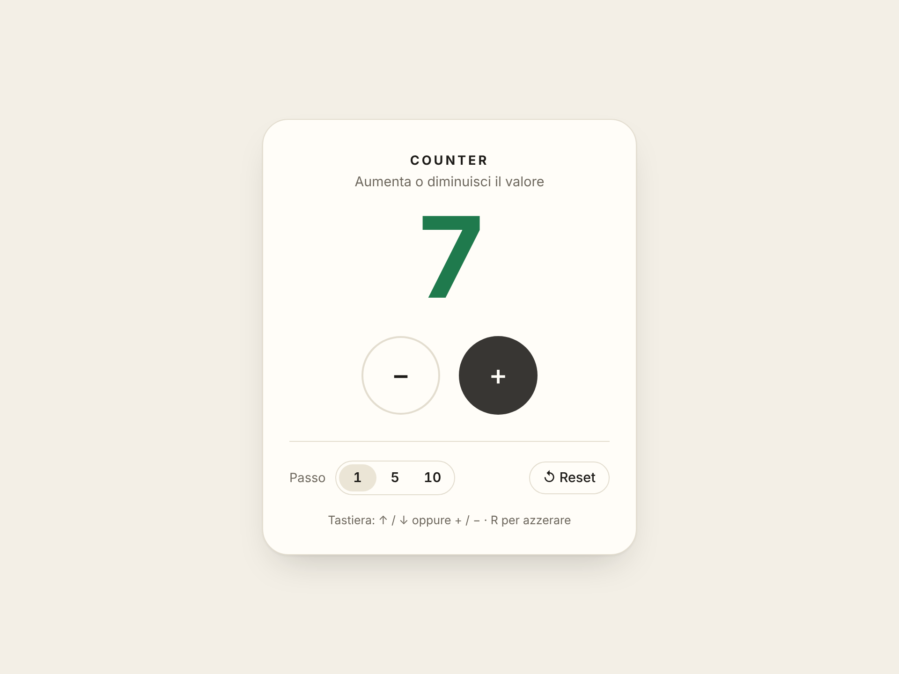
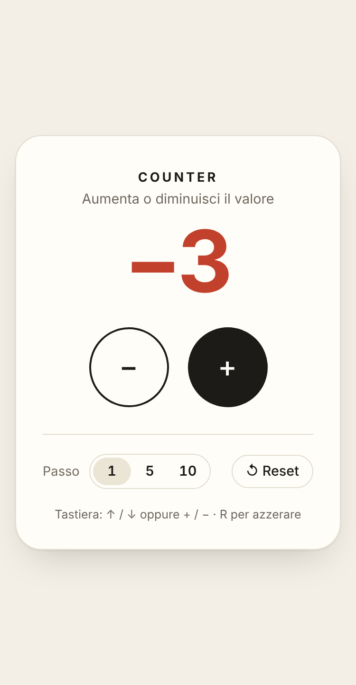

<div align="center">


# Counter App

Un contatore web realizzato in **JavaScript puro**: l'interfaccia viene creata interamente tramite la manipolazione del DOM.

### 🔗 [**PROVA L'APPLICAZIONE ONLINE**](https://rafeola.github.io/counterApp/)

`https://rafeola.github.io/counterApp/`


</div>

---

## Indice

1. [Descrizione](#descrizione)
2. [Screenshot](#screenshot)
3. [Funzionalità](#funzionalità)
4. [Tecnologie utilizzate](#tecnologie-utilizzate)
5. [Struttura del progetto](#struttura-del-progetto)
6. [Come funziona il codice](#come-funziona-il-codice)
7. [Avviare il progetto in locale](#avviare-il-progetto-in-locale)
8. [Test effettuati](#test-effettuati)
9. [Autore](#autore)

---

## Descrizione

L'applicazione simula il comportamento di un counter (contatore). All'apertura della pagina il valore è impostato a **0** e l'utente può aumentarlo o diminuirlo con i pulsanti **+** e **−**.

Il file `index.html` contiene soltanto un contenitore vuoto (`<main id="app">`): titolo, valore e pulsanti vengono creati dinamicamente da JavaScript con `document.createElement`. Non vengono usati jQuery né framework come React, Angular o Vue.

## Screenshot

<p align="center">
  
</p>

<p align="center">
  
</p>

## Funzionalità

### Richieste dal progetto

- ✅ Valore iniziale del counter impostato a **0**
- ✅ Pulsante **+** per incrementare il valore
- ✅ Pulsante **−** per decrementare il valore
- ✅ Interfaccia creata dinamicamente tramite JavaScript (DOM)

### Funzionalità aggiuntive

- 💾 **Salvataggio automatico**: il valore e il passo vengono salvati nel `localStorage`, quindi restano anche dopo aver ricaricato la pagina.
- 🔢 **Passo personalizzabile**: si può scegliere se aumentare o diminuire di **1**, **5** o **10** a ogni clic. Le etichette dei pulsanti si aggiornano (es. `+5`, `−5`).
- ↺ **Reset**: riporta il counter a 0 con un clic.
- ⌨️ **Scorciatoie da tastiera**:

  | Tasto | Azione |
  |---|---|
  | `↑` oppure `+` | Aumenta |
  | `↓` oppure `-` | Diminuisce |
  | `R` | Azzera |

- 🎨 **Colore in base al segno**: il valore è verde quando è positivo e rosso quando è negativo.
- ✨ **Animazione** leggera a ogni cambio di valore (disattivata automaticamente se l'utente preferisce ridurre le animazioni).
- 🌙 **Tema scuro automatico**, in base alle impostazioni del sistema operativo.
- 📱 **Design responsive**, utilizzabile anche da smartphone.
- ♿ **Accessibilità**: pulsanti con `aria-label`, valore letto dagli screen reader a ogni modifica (`aria-live`), focus visibile durante la navigazione da tastiera.

## Tecnologie utilizzate

- **HTML5**
- **CSS3** (variabili CSS, Flexbox, Grid, media query, animazioni)
- **JavaScript (ES6+)** puro, senza librerie né framework
- **Google Fonts** (Inter e Space Grotesk)

## Struttura del progetto

```
counterApp/
├── index.html            → pagina principale (contiene solo il contenitore #app)
├── README.md             → documentazione del progetto
├── css/
│   └── style.css         → stile dell'applicazione
├── js/
│   ├── storage.js        → salvataggio e lettura dello stato (localStorage)
│   ├── counter.js        → logica del counter (cambio valore)
│   ├── ui.js             → creazione dinamica dell'interfaccia e visualizzazione del valore
│   └── app.js            → punto di ingresso: collega logica, interfaccia ed eventi
└── img/
    ├── favicon.svg       → icona della pagina
    ├── screenshot.png    → screenshot desktop
    └── screenshotMobile.png → screenshot mobile
```

Tutti i nomi di file, funzioni, variabili e classi CSS seguono la convenzione **camelCase**.

## Come funziona il codice

Il codice JavaScript è diviso in file con compiti separati, così ogni parte è più semplice da leggere e da modificare.

| File | Responsabilità | Funzioni principali |
|---|---|---|
| `counter.js` | **Cambio del valore.** Contiene lo stato e le funzioni che lo modificano. Non accede mai al DOM. | `initCounter()`, `increment()`, `decrement()`, `resetCounter()`, `setStep()`, `getValue()`, `getState()` |
| `ui.js` | **Visualizzazione del valore.** Crea gli elementi dell'interfaccia e li aggiorna. Non contiene calcoli. | `createDomElement()`, `buildCounterUi()`, `renderValue()`, `renderStep()` |
| `storage.js` | **Salvataggio.** Legge e scrive lo stato nel `localStorage`. | `saveState()`, `loadState()` |
| `app.js` | **Collegamento.** Avvia l'app e gestisce gli eventi (clic e tastiera). | `initApp()`, `bindEvents()`, `updateCounter()`, `handleKeydown()` |

Il flusso di un clic sul pulsante **+** è:

```
clic su "+"  →  increment()  →  renderValue()  →  saveState()
               (counter.js)      (ui.js)           (storage.js)
```

Esempio: creazione dinamica di un elemento (`ui.js`)

```js
function createDomElement(tagName, className, textContent = "") {
  const element = document.createElement(tagName);
  element.className = className;
  element.textContent = textContent;
  return element;
}
```

Esempio: logica del cambio valore (`counter.js`)

```js
function increment() {
  counterState.value += counterState.step;
  return counterState.value;
}
```

> I file JavaScript sono caricati come script classici con l'attributo `defer`, nell'ordine `storage.js → counter.js → ui.js → app.js`. In questo modo l'app funziona sia online sia aprendo direttamente `index.html` con un doppio clic, senza bisogno di un server locale.

## Avviare il progetto in locale

1. Clona il repository:

   ```bash
   git clone https://github.com/Rafeola/counterApp.git
   ```

2. Entra nella cartella:

   ```bash
   cd counterApp
   ```

3. Apri `index.html` nel browser (doppio clic sul file, oppure con l'estensione **Live Server** di VS Code).

Non è necessaria nessuna installazione.

## Test effettuati

L'applicazione è stata verificata su Chrome desktop e in visualizzazione mobile:

- valore iniziale uguale a 0;
- incremento e decremento con i pulsanti, anche con clic rapidi e ripetuti;
- gestione dei valori negativi;
- cambio del passo (1, 5, 10);
- reset;
- scorciatoie da tastiera;
- salvataggio del valore dopo il ricaricamento della pagina;
- nessun errore nella console;
- nessuno scroll orizzontale su schermi stretti (375 px).

## Autore

**Raffaele Feola**

- GitHub: [@Rafeola](https://github.com/Rafeola)
